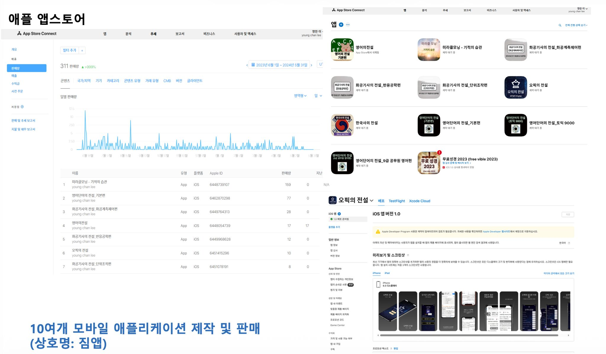
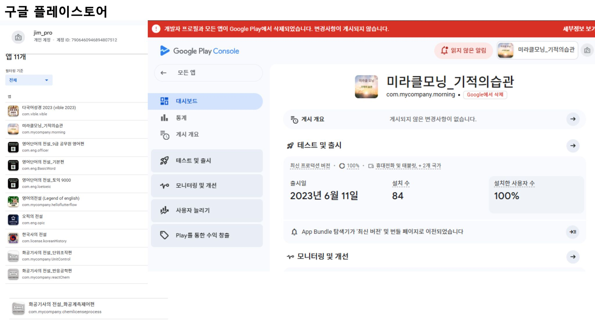

# 이영찬 · JimProKing

**공공 전산 실무를 하면서, 보안을 손으로 정리하고 코드로 다시 만들어 보는 사람입니다.**

화학공학 → 공정 엔지니어 → 1인 앱 사업(Flutter 앱 10여 개 출시) → 국가기관 전산직.  
출시한 앱이 해킹 피해를 입은 뒤로 보안을 본격적으로 공부하기 시작했고, 정보보안기사를 취득했습니다.

| 지금 | 자격 | 관심 분야 |
| --- | --- | --- |
| 국가기관 전산 (요구분석 · 유지보수 · 테스트) | 정보보안기사 · 정보처리기사 | 웹/API 취약점 → 탐지 · 컨테이너 · 인프라 보안 |

---

## 이 프로필 읽는 법

저장소는 세 층으로 되어 있습니다.

1. **손필기** — 강의·책·랩을 먼저 종이에 정리합니다. 원본 사진을 그대로 올립니다.
2. **실습 랩 · write-up** — 필기한 내용을 Burp, Docker, 파이썬으로 직접 재현하고 기록합니다.
3. **도구** — 반복하게 되는 일은 웹앱이나 스크립트로 만들어 배포합니다.

모든 저장소 README는 같은 형식입니다. 맨 위 표에서 **분류 · 상태 · 스택 · 바로 보기**를 확인할 수 있고, 맨 아래에 관련 저장소가 이어집니다.

---

## 손으로 정리한 노트

공부는 종이에서 시작합니다. 아래는 각 저장소에 원본 그대로 올린 필기입니다. 사진을 누르면 해당 저장소로 이동합니다.

<table>
  <tr>
    <td width="33%" valign="top">
      
       <b><a href="https://github.com/JimProKing/docker-notes">docker-notes</a></b> 
      namespace · cgroup · 이미지 레이어 · compose. 필기 4장 + 파이썬 예제
    </td>
    <td width="33%" valign="top">
      
       <b><a href="https://github.com/JimProKing/info-sec-memo">info-sec-memo</a></b> 
      정보보안기사 기출을 손글씨로 압축한 82쪽. 웹에서 넘기며 암기
    </td>
    <td width="33%" valign="top">
      
       <b><a href="https://github.com/JimProKing/blockchain-security-notes">blockchain-security-notes</a></b> 
      트랜잭션 · 컨트랙트 호출 · 재진입. 드림핵 워게임 #1335–#1341
    </td>
  </tr>
  <tr>
    <td width="33%" valign="top">
      
       <b><a href="https://github.com/JimProKing/File-Path-Traversal-simple">File-Path-Traversal-simple</a></b> 
      PortSwigger 랩. Burp 화면 위에 손글씨로 흐름을 적은 풀이
    </td>
    <td width="33%" valign="top">
      
       <b><a href="https://github.com/JimProKing/Unprotected-Admin-Functionality-simple">Unprotected-Admin-Functionality-simple</a></b> 
      접근 통제 랩 5개. 수직·수평 권한 상승을 화면마다 주석
    </td>
    <td width="33%" valign="top">
      
       <b><a href="https://github.com/JimProKing/info-sec-memo">info-sec-memo</a></b> 
      시스템 · 네트워크 · 웹 · 법규를 과목별로 묶은 암기장
    </td>
  </tr>
</table>

---

## 프로젝트 지도

### 탐지 · 방어 · 인프라

| 저장소 | 한 줄 | 종류 | 바로 보기 |
| --- | --- | --- | --- |
| [aegis-cortex](https://github.com/JimProKing/aegis-cortex) | 인증·방화벽·프록시·DNS·EDR 로그를 상관분석해 킬체인을 재구성하고 ATT&CK로 매핑 | 도구 | — |
| [docker-notes](https://github.com/JimProKing/docker-notes) | 컨테이너 격리(namespace·cgroup)와 명령어를 손필기 + 파이썬 예제로 | 손필기 · 노트 | — |
| [optical-qr-transfer](https://github.com/JimProKing/optical-qr-transfer) | 네트워크 없이 화면 QR과 카메라만으로 파일 전송. 에어갭·망분리 실험 | 도구 | [시연 GIF](https://github.com/JimProKing/optical-qr-transfer#시연) |

### 웹 · API 보안 실습

| 저장소 | 한 줄 | 종류 | 바로 보기 |
| --- | --- | --- | --- |
| [webhacking-bible-lab](https://github.com/JimProKing/webhacking-bible-lab) | 《웹 해킹 바이블》 문제 01–20을 푸는 의도적 취약 게시판 | 실습 랩 | [Live](https://web-production-debfb.up.railway.app/) |
| [VulnBoard](https://github.com/JimProKing/VulnBoard) | 위 랩의 첫 버전. SQLi · Stored XSS · IDOR · 파일 업로드 · Command Injection | 실습 랩 | — |
| [sql-injection-lab](https://github.com/JimProKing/sql-injection-lab) | Flask/JSP로 취약 코드와 PreparedStatement 방어를 나란히 비교 | 실습 랩 | — |
| [api-hacking-notes](https://github.com/JimProKing/api-hacking-notes) | 《API 해킹의 모든 것》 기반. REST/GraphQL · BOLA · JWT · 퀴즈 | 학습 웹 | [Live](https://api-hacking-notes-production.up.railway.app/) |
| [Unprotected-Admin-Functionality-simple](https://github.com/JimProKing/Unprotected-Admin-Functionality-simple) | PortSwigger 접근 통제 랩 5개 풀이 + 점검 스크립트 | write-up · 손글씨 주석 | — |
| [File-Path-Traversal-simple](https://github.com/JimProKing/File-Path-Traversal-simple) | PortSwigger Path Traversal 풀이 + Burp 없이 재현하는 스크립트 | write-up · 손글씨 주석 | — |
| [dreamhack](https://github.com/JimProKing/dreamhack) | Dreamhack Path와 워게임. 관찰 → 가설 → 검증 순서로 기록 | 학습 기록 | — |
| [blockchain-security-notes](https://github.com/JimProKing/blockchain-security-notes) | 스마트 컨트랙트 · DeFi 보안. 손필기 + 워게임 풀이 | 손필기 · 학습 기록 | — |
| [google-hacking-notes](https://github.com/JimProKing/google-hacking-notes) | Google dork · GHDB 연산자와 내 서비스 노출 점검 패턴 | 노트 | — |

### 자격 · 교육 도구

| 저장소 | 한 줄 | 종류 | 바로 보기 |
| --- | --- | --- | --- |
| [info-sec-memo](https://github.com/JimProKing/info-sec-memo) | 정보보안기사 손글씨 요약 82쪽을 웹에서 넘기며 암기 | 손필기 · 웹 | [Live](https://web-production-b5e1a.up.railway.app/) |
| [security-exam-study](https://github.com/JimProKing/security-exam-study) | 정보보안기사 실기 단답·서술·실무형을 숨김/펼침으로 연습 | 웹 | — |
| [aegis-protocol](https://github.com/JimProKing/aegis-protocol) | CIA부터 탐지·대응까지 10개 작전으로 판단력을 훈련하는 브라우저 게임 | 교육 게임 | — |

### 제품 · 접근성

| 저장소 | 한 줄 | 종류 | 바로 보기 |
| --- | --- | --- | --- |
| [subtitle-voice](https://github.com/JimProKing/subtitle-voice) | 극장 한글 자막을 카메라로 읽어 기기 TTS로 들려주는 접근성 웹앱. 영상은 기기를 떠나지 않음 | 웹앱 | — |
| [spatial-perception-training](https://github.com/JimProKing/spatial-perception-training) | 정육면체 전개도 · 쌓기나무 3D 연습 게임. Windows 설치파일 배포 | 데스크톱 앱 | — |
| [cube-net-lab](https://github.com/JimProKing/cube-net-lab) | 정육면체를 접고 펼치며 전개도 11종을 확인하는 웹앱 | 웹앱 | — |
| [brush-zombie-fps](https://github.com/JimProKing/brush-zombie-fps) | 붓을 던지는 1인칭 미니 게임 (Three.js + Electron) | 게임 | — |
| [portfolio-youngchan](https://github.com/JimProKing/portfolio-youngchan) | 개인 소개 웹사이트 | 웹 | [Live](https://web-production-d48cbf.up.railway.app/) |

### 데이터 · 핀테크

| 저장소 | 한 줄 | 종류 | 바로 보기 |
| --- | --- | --- | --- |
| [xrp-dashboard](https://github.com/JimProKing/xrp-dashboard) | XRPL 온체인 · 거래소 거래량 · 김치 프리미엄 · 실시간 차트 | 대시보드 | [Live](https://web-production-7a41a.up.railway.app/) |
| [elliott-wave-scanner](https://github.com/JimProKing/elliott-wave-scanner) | 바이낸스 상위 종목 엘리어트 파동 스캐너. GitHub Actions로 4시간마다 갱신 | 도구 | [Live](https://elliott-focused-viewer-production.up.railway.app/) |
| [longshort-han-nune](https://github.com/JimProKing/longshort-han-nune) | BTC·ETH·XRP 롱/숏 비율 · 지지선 · 진입/손절 시나리오 | 웹앱 | [Live](https://web-production-e7d0f.up.railway.app/) |
| [xrpl_examples](https://github.com/JimProKing/xrpl_examples) | XRPL 기능별 파이썬 예제 12개 (지갑 · 송금 · DEX · NFT · 에스크로) | 예제 | — |
| [elliott-wave-stock-recommender](https://github.com/JimProKing/elliott-wave-stock-recommender) | KOSPI·KOSDAQ 거래대금 상위 종목 파동 점수화 | 도구 | — |

### Flutter 앱 (1인 사업 · 짐앱)

교육 · 자격 대비 앱 10여 개를 기획부터 App Store / Google Play 출시·판매까지 혼자 운영했습니다.  
소스 일부: [MiracleMorning](https://github.com/JimProKing/MiracleMorning) · [Legend_Of_Eng_Basic](https://github.com/JimProKing/Legend_Of_Eng_Basic) · [LOC_ProcessControll](https://github.com/JimProKing/LOC_ProcessControll)

  
  

<b>기초 · 연습 저장소</b> (파이썬 · 백엔드 · 자료구조, 펼쳐 보기)

| 저장소 | 한 줄 |
| --- | --- |
| [python-data-structures](https://github.com/JimProKing/python-data-structures) | 학부 교과서 방식의 자료구조 구현 + 복잡도 + 테스트 |
| [data_structure](https://github.com/JimProKing/data_structure) | 자료구조 · 알고리즘 챕터별 구현 |
| [Cording_Test](https://github.com/JimProKing/Cording_Test) | 코딩테스트 유형별 풀이 (그리디 · 탐색 · 정수론) |
| [Event_Planner_with_fastapi](https://github.com/JimProKing/Event_Planner_with_fastapi) | FastAPI + SQLModel 이벤트 플래너 |
| [FastAPI_PY_PRA](https://github.com/JimProKing/FastAPI_PY_PRA) | 《파이썬 FastAPI 개발 입문》 실습 + Docker 이미지 |
| [FastAPI_Real](https://github.com/JimProKing/FastAPI_Real) | FastAPI 단계별 학습 계획 (LV1–LV5) |
| [Simple_Sleep_tracking](https://github.com/JimProKing/Simple_Sleep_tracking) | FastAPI + Supabase 수면 기록 앱 |
| [Django_first](https://github.com/JimProKing/Django_first) | Django 튜토리얼(polls)과 크롤링 모듈 |
| [Web_Crawling](https://github.com/JimProKing/Web_Crawling) | Playwright로 쇼핑 트렌드 수집 → 워드 리포트 자동 생성 |
| [market_capitalization_analysis](https://github.com/JimProKing/market_capitalization_analysis) | 네이버 증권 시가총액 수집 · 분석 |
| [Naver_Shopping_Related_Keyword](https://github.com/JimProKing/Naver_Shopping_Related_Keyword) | 네이버 쇼핑 검색 API로 연관 키워드 수집 |
| [OCR_Pra](https://github.com/JimProKing/OCR_Pra) | EasyOCR 문자 인식 + Streamlit 번역 웹앱 |
| [QR_Python](https://github.com/JimProKing/QR_Python) | vCard 명함 QR에 사진 넣기 |
| [image_collage_py](https://github.com/JimProKing/image_collage_py) | 사진 40장 콜라주 + 한글 워터마크 |
| [Card_Log_Practice](https://github.com/JimProKing/Card_Log_Practice) | 카드 명세서 통합 · 월별 지출 시각화 |
| [Example_of_Visualizing_Data](https://github.com/JimProKing/Example_of_Visualizing_Data) | 폴더 크기 데이터 막대그래프 시각화 |
| [Measuring-folder-size-Program_Python](https://github.com/JimProKing/Measuring-folder-size-Program_Python) | pathlib 재귀 디렉터리 용량 분석기 |
| [XRP-Pra](https://github.com/JimProKing/XRP-Pra) · [XRPL_Basic_Web](https://github.com/JimProKing/XRPL_Basic_Web) | XRPL 첫 실습 노트북과 지갑 조회 웹 (보관) |
| [three-dimensional_figure](https://github.com/JimProKing/three-dimensional_figure) | Plotly 입체도형 시각화 |
| [pinkmiya](https://github.com/JimProKing/pinkmiya) | 바이브 코딩 시연용 Flask 쇼핑몰 데모 |
| [Legend_Of_Eng_Basic](https://github.com/JimProKing/Legend_Of_Eng_Basic) · [LOC_ProcessControll](https://github.com/JimProKing/LOC_ProcessControll) · [MiracleMorning](https://github.com/JimProKing/MiracleMorning) | 출시 앱 Flutter 소스 |
| [PersonalInfo](https://github.com/JimProKing/PersonalInfo) | 출시 앱 개인정보처리방침 페이지 |
| [Python_AllInOne](https://github.com/JimProKing/Python_AllInOne) · [React_With_TS](https://github.com/JimProKing/React_With_TS) · [streamlit_Pra](https://github.com/JimProKing/streamlit_Pra) | 연습용 빈 저장소 (예정) |

---

## 걸어온 길

| 시기 | 무엇을 했나 |
| --- | --- |
| ~2021 | 경상국립대학교 화학공학 (P&P화학공학 융합전공) |
| 이후 약 1년 | 화학 엔지니어. 공정 자동화 프로그램을 개인 프로젝트로 만들다가 개발에 적성을 찾음 |
| 2022–2023 | 1인 사업자 짐앱. Flutter 교육 앱 10여 개를 iOS·Android에 출시·판매 |
| 이후 | 출시 앱 해킹 피해 → 보안 공부 시작. 국가직 9급 전산직 합격 |
| 현재 | 국가기관 전산 업무 + 웹·API 보안 실습 공개. 정보보안기사 취득 |

## 다룰 수 있는 것

| 영역 | |
| --- | --- |
| 보안 | 웹/API 취약점(SQLi · XSS · IDOR · 접근 통제 · Path Traversal · SSRF), Burp Suite, 취약 랩 설계, 로그 상관 · IOC · ATT&CK |
| 인프라 | Docker · Docker Compose, Linux, GitHub Actions, Railway 배포 |
| 언어 | Python, Java, JavaScript, Dart, SQL |
| 업무 스택 | Java · Spring · JSP · WebSquare · DB2 · XML 전문 · 형상관리 · 테스트 |
| 백엔드 | FastAPI, Flask, Django, Express, SQLite |

## 연락

- Email: caramel2516@naver.com
- KakaoTalk: caramel112

공공기관 소속은 기관명 없이 "국가기관"으로만 적습니다. 업무 시스템과 미공개 취약점 내용은 공유하지 않습니다.

---

<b>English</b>

**Young-chan Lee (JimProKing)** — public-sector IT engineer studying security by writing it down by hand, then rebuilding it in code.

Chemical engineering → plant process engineer → indie developer (10+ Flutter apps shipped to App Store / Google Play) → IT at a national institution. After one of my apps was hacked I turned to security and earned the Korean *Information Security Engineer* certification.

- **Handwritten notes:** docker-notes, info-sec-memo (82 pages), blockchain-security-notes, PortSwigger write-ups with annotated screenshots
- **Labs:** webhacking-bible-lab, VulnBoard, sql-injection-lab, api-hacking-notes, dreamhack
- **Defensive tooling:** aegis-cortex (multi-source log correlation, IOC matching, ATT&CK mapping), optical-qr-transfer (air-gapped file transfer experiment)
- **Shipping:** 10+ mobile apps, several Railway-deployed web apps, GitHub Actions pipelines

Contact: caramel2516@naver.com

